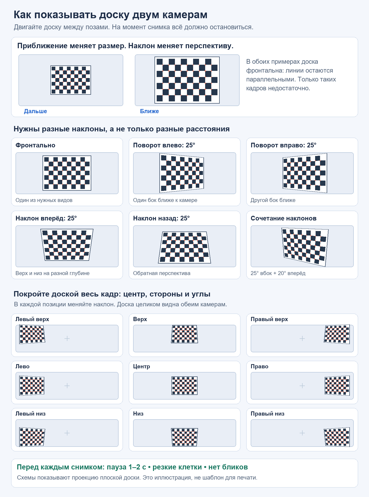

# Калибровка, ближняя глубина и заполнение 3D-карты

Для этой камеры сначала нужно получить качественную калибровку и включить подходящий ближний поиск. В последней проверке обнаружены обе проблемы: слабый набор калибровочных ракурсов и настройки быстрого режима, которые отсекают предметы ближе примерно 28 см.

В приложении 0.9 добавлены кнопка **«Как правильно снять калибровку…»**, счётчик наклонных ракурсов и предварительная проверка перед расчётом. Дополнительно исправлена чрезмерная отбраковка обычных поверхностей строгим фильтром NVIDIA. В объёмном снимке начните с **обычной** защиты; три согласованных наблюдения для накопления сохраняются. Строгая проверка полезна для сомнительных повторяющихся деталей, но даёт больше пропусков.

## Что показала проверка ваших данных

| Серия | RMS, пиксели | Вертикальное расхождение, пиксели | Разнообразие ракурсов |
|---|---:|---:|---|
| Новая серия 19:49 | 1,424 | 1,848 | Заметный наклон только у 4 из 16 пар |
| Новая серия 19:51 | 7,479 | 31,832 | Заметный наклон не обнаружен у 15 пар |

Центр доски перемещался только в узкой области: около 15,6% ширины × 18,8% высоты кадра в первой серии и 9,7% × 12,4% во второй. Эти серии не дают надёжной калибровки всего изображения. Особенно велико расхождение второй серии: с такой геометрией сопоставление по горизонтальным строкам работать правильно не будет. Недостаток наклонов и покрытия — обнаруженные слабые места; по одному числу ошибки нельзя установить все причины отказа.

Сохранённая рабочая калибровка имеет разрешение **1280 × 720**, базу **60,118 мм**, RMS **1,519 пикселя** и вертикальное расхождение **0,994 пикселя**. Это почти порог принятия, а не свидетельство миллиметровой точности. Для измерений листьев её стоит заменить более качественной и проверить независимым эталоном.

При запросе **Full HD / 60 кадров/с** в диагностике запуск 60 кадров не удался, после чего захват переключился на 30. Для новой серии начните с **1280 × 720 / 30 кадров/с**. Большое число кадров в секунду само по себе не улучшает геометрическую калибровку: нужны разные резкие положения доски.

## Подготовка

1. Подключите камеру напрямую к компьютеру. Выберите **1280 × 720**, **30 кадров/с**, устойчивый способ подключения. Для Full HD потребуется отдельная серия в **1920 × 1080 / 30**; не смешивайте разрешения в одной серии.
2. Протрите объективы. Осветите доску ровно, без бликов и пересвеченных белых клеток. Все внутренние углы должны быть видны обеим камерам.
3. Если фокус регулируется, настройте его до съёмки и затем не меняйте. После изменения фокуса, зума или положения объективов калибровку надо повторить. Не поворачивайте объективы на неизвестной плате без понимания их крепления.
4. Для точной работы предпочтительна **матовая распечатка на плоской жёсткой основе**. Мятый лист, изгиб доски, блики и муар экрана создают дополнительные ошибки. Экранная доска подходит для проб, но требует проверки физического масштаба линейкой.
5. При **9 × 6 внутренних углах** рисунок содержит **10 × 7 клеток**. Ваш размер клетки **17,033 мм** даёт рисунок примерно **170,33 × 119,23 мм**, без внешних полей. Измерьте длину десяти клеток и поделите на десять; если получается другое значение, введите измеренное. Для печати используйте фактический размер без подгонки под страницу и всё равно проверьте линейкой.
6. Такая доска может не помещаться в общем поле зрения на 15 см. Снимайте примерно с **30–70 см**, подбирая расстояние по резкости и видимости всей доски. Не приближайте её ценой обрезанных углов. После калибровки не перефокусируйте камеру ради ближнего объекта.

Если при фокусе для ближних объектов доска на 30–70 см уже нерезкая, **уменьшите физический размер клеток**, чтобы всю доску можно было снять в резком рабочем диапазоне. Например, 10 × 7 клеток по 10 мм дают рисунок 100 × 70 мм, который проще разместить в общем виде на 15 см. Видимость всё равно проверьте по обеим камерам. Укажите измеренный размер клетки и начните новую серию; нельзя смешивать клетки разного размера в одной серии. Указанные расстояния — ориентир, а резкость и общая видимость обязательны.

OpenCV объясняет различие между клетками и внутренними углами, необходимость разных положений и влияние точности физической доски: [Camera calibration With OpenCV](https://docs.opencv.org/4.x/d4/d94/tutorial_camera_calibration.html).

**Если доска на неподвижном мониторе:** перемещайте всю стереопару, смотрите на экран слева/справа и сверху/снизу, направляя камеру на доску. Это меняет её наклон относительно плоскости экрана. Перемещение только вперёд/назад сохраняет фронтальный вид. Не меняйте взаимное положение объективов и платы; замирайте после каждой перестановки. При заметном муаре лучше перейти на матовую печать.

## Конкретный план: 33 разных положения

**Не снимайте серию, непрерывно двигая доску.** Переставьте её, остановите камеру и доску на **1–2 секунды**, затем снимите одну пару. Это особенно важно, поскольку аппаратная синхронизация двух потоков этой камеры не подтверждена.

| Группа | Сколько пар | Как снимать |
|---|---:|---|
| Покрытие кадра | 9 | Центр; верх, низ, лево, право; четыре угла. Доска целиком видна обеим камерам, углы подходят близко к краям, но не обрезаются. |
| Поворот влево/вправо | 8 | По 4 пары на сторону с наклоном примерно 20–35°. Один бок доски ближе другого. Меняйте также положение в кадре. |
| Наклон вперёд/назад | 8 | По 4 пары в каждую сторону примерно на 20–35°. Верхний и нижний края на разной глубине. |
| Сочетания | 4 | Одновременно наклоните вбок и вперёд/назад. Не доводите до почти ребра: клетки должны оставаться различимыми. |
| Другой масштаб | 4 | Две пары немного ближе и две немного дальше. Добавьте умеренный наклон; не повторяйте один фронтальный вид. |

Итого **33 пары**. Это практический стартовый набор, а не гарантия точности. Обычно доска должна занимать заметную часть изображения — примерно **40–80%** соответствующего размера, если это позволяет увидеть её целиком в обеих камерах. У краёв можно отодвинуть доску. Меняйте расстояние и размер, но не заменяйте ими наклоны.

**Как отличить наклон от приближения:** при простом приближении фронтальная доска становится больше, но форма остаётся прямоугольной. При наклоне один край становится ближе, появляется перспектива: противоположные края выглядят неодинаково. Поворот рисунка в плоскости кадра тоже не заменяет наклон по глубине.

Удаляйте смазанные, бликующие, повторяющиеся и неправильно распознанные пары. Для хорошего результата важнее полезное разнообразие, чем сотни практически одинаковых кадров. Разработчики mrcal подчёркивают необходимость покрытия краёв, наклонов, неподвижности при несинхронном захвате и сохранения настройки объектива: [How to run a calibration](https://mrcal.secretsauce.net/how-to-calibrate.html).

## Проверка после расчёта

1. Покажите доску в **новых положениях**, которые не входили в расчёт: центр, левый/правый края, умеренные наклоны. Включите линии проверки выравнивания: одинаковые углы на левой и правой картинке должны попадать на одинаковые горизонтальные линии.
2. Если программа отклоняет калибровку по вертикальному расхождению, не пытайтесь получить точность ослаблением порога. Пересмотрите пары и переснимите слабые ракурсы. Сохраните удачную серию отдельно.
3. Положите предмет с независимо измеренной длиной, например 50 или 100 мм, на расстоянии 15 см, затем 30 см. Начните с расстояния, на котором обе картинки резкие и общий участок хорошо виден. Повторите измерение **5–10 раз** после новых захватов.
4. Проверьте **две величины**: насколько результат отличается от эталона и насколько меняется между повторами. Одинаково повторяющиеся неверные 103 мм вместо 100 мм — систематическая ошибка, а не высокая точность.
5. Повторите проверку ближе к краям изображения. Не используйте только саму калибровочную доску как единственный эталон: её размер уже участвовал в настройке масштаба.

RMS и вертикальная ошибка измеряются в пикселях. Они помогают оценить калибровку, но не являются прямой гарантией ошибки измерения в миллиметрах.

## Почему вблизи всё чёрное и что выставить

В проверенном быстром профиле были выбраны **ширина расчёта 640**, **поиск 96 пикселей**, **ближний приоритет выключен**. С текущей геометрией это даёт нижнюю границу поиска примерно **28,1 см**. Объект на 15 см требует смещения около **177,7 пикселя**, на 10 см — **266,6 пикселя**: основной диапазон 96 их не охватывает.

Для первой проверки близкого предмета после новой калибровки:

| Параметр | Значение |
|---|---|
| Захват | 1280 × 720 / 30 кадров/с |
| Профиль | Для предметов с 15 см |
| Ширина расчёта | 960 |
| Основной поиск | 192 пикселя |
| Приоритет близких предметов | Включён |
| Ближняя граница | 10 см |
| Широкий обзор | Включён |
| Максимальная глубина | 0,8 м для ближнего опыта |
| Шаг карты | 1 мм |
| Шаг выборки | 1 |

Ближний поиск добавляет отдельные диапазоны сверх основного. Без него 192 пикселя при ширине 960 не означают измерение от 10 см. Если на 10–15 см текст и рисунок в исходных изображениях уже размыты, параметры стерео не вернут потерянную резкость. Также предмет должен быть одновременно виден **обоим** объективам: область пересечения вблизи уменьшается, а перекрытия увеличиваются.

Начните с матового предмета с неповторяющимся рисунком при ровном свете, примерно с 25–30 см. Затем приближайте по несколько сантиметров, проверяя резкость и измеренные точки. Клавиатура, глянец и белая стена — трудные первые тесты.

## Как получить более полную карту без выдуманных измерений

Пассивное стерео определяет глубину по совпадениям в двух изображениях. На однотонном участке совпадений мало; у одинаковых клавиш их несколько; блики выглядят по-разному с двух сторон. Поэтому уверенно измеряются контуры и текстурированные участки, а остальные могут остаться чёрными. [OpenCV описывает эти трудности и отбраковку ненадёжной глубины](https://docs.opencv.org/4.x/d3/d14/tutorial_ximgproc_disparity_filtering.html).

Накопление помогает подавить случайный шум. Медленное смещение вбок и немного вверх/вниз даёт новые наблюдения и открывает перекрытые участки. Делайте паузы и сохраняйте общий предмет в кадре; если отслеживание положения теряется, остановитесь. Длительное наблюдение с почти неизменного ракурса не гарантирует исправления стабильного неверного совпадения или измерения совершенно однотонной поверхности.

Полезный эксперимент для белых поверхностей — **обычный видимый проектор с мелким непериодическим рисунком**, различимым обеими камерами. Он добавляет реальные признаки для сопоставления. ИК-проектор нельзя выбирать для HBVCAM без проверки фильтров и чувствительности её сенсоров. Принцип и пример видимого проектора приведены в [RealSense: Projectors for D400 Series Depth Cameras](https://dev.realsenseai.com/docs/projectors/); характеристики RealSense не являются характеристиками вашей камеры.

Заполнение неизвестных участков интерполяцией делает модель визуально сплошнее, но это **предположение о поверхности**, а не дополнительный замер. Такие точки следует хранить и показывать отдельно, не использовать для миллиметровых измерений листа. Причины пропусков и этот выбор для 3D-сканирования подробно разобраны в [RealSense: Depth Post-Processing](https://dev.realsenseai.com/docs/depth-post-processing-for-intel-realsense-depth-camera-d400-series/).

Камера не измеряет все точки пространства: карта описывает видимые поверхности. Скрытую обратную сторону нужно увидеть из другого положения. Лидар также не гарантирует отсутствие пропусков всех материалов и перекрытий.

## Что означает цель «1 мм»

Размер вокселя 1 мм — шаг хранения карты, а не удостоверенная точность. Для стерео глубина приблизительно равна `Z = f × B / d`; чувствительность к ошибке смещения растёт как `Z² / (f × B)`. Квадратичную зависимость подтверждает [Stereolabs: Depth Sensing](https://docs.stereolabs.com/docs/development/zed-sdk/modules/depth-sensing).

Для вашей текущей калибровки при **ширине расчёта 640** (`f ≈ 443,5 пикселя`, `B ≈ 0,0601 м`) идеальная чувствительность к смещению на **1 пиксель** составляет примерно:

| Расстояние | Изменение глубины на 1 пиксель смещения |
|---|---:|
| 15 см | 0,844 мм |
| 1 м | 37,5 мм |
| 3 м | 337,6 мм |

Даже условная ошибка **0,1 пикселя** даёт около **3,75 мм на 1 м** и **33,76 мм на 3 м** только от сопоставления, ещё без ошибок оптики, калибровки и сшивки. Это приближённая оценка чувствительности, а не измеренная паспортная точность. Более высокое разрешение улучшает эту составляющую при сохранении резкости, но увеличивает нагрузку.

Различение изменения листа на 1 мм нужно проверять **в фиксированном ближнем диапазоне по эталону**. Полная живая карта комнаты с гарантированной абсолютной точностью 1 мм текущей камерой не подтверждена; программно обещать это нельзя. Маленькие пропуски лучше оставлять обозначенными, чем выдавать достроенную поверхность за достоверное измерение.
